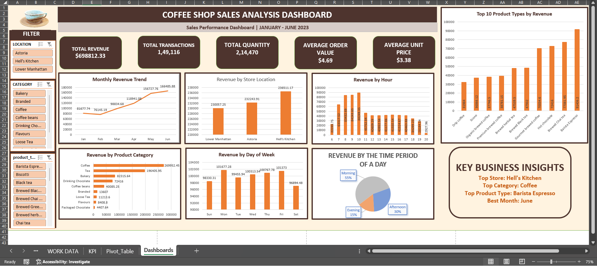

# ☕ Coffee Shop Sales Analysis & Interactive Dashboard

An Excel-based data analytics project focused on analyzing coffee shop sales performance, identifying trends, and presenting business insights through an interactive dashboard.

## 📊 Dashboard Preview

## 📌 Project Overview

This project analyzes transaction-level coffee shop sales data using Microsoft Excel. The dashboard transforms raw sales records into meaningful visualizations and key performance indicators (KPIs) to help understand revenue, product demand, store performance, and sales trends.

The project demonstrates practical skills in data analysis, data visualization, business reporting, and Excel dashboard development.

## 🎯 Project Objectives

- Analyze overall sales and transaction performance.
- Track revenue and quantity sold.
- Evaluate product categories and product types.
- Explore sales trends by month, day of the week, and hour.
- Compare sales performance across store locations.
- Develop an interactive dashboard for business reporting.
- Present data in a clear and actionable format.

## 🛠️ Tools & Technologies

- **Microsoft Excel** — Data analysis and dashboard development
- **PivotTables** — Data summarization and aggregation
- **PivotCharts** — Visual representation of sales metrics
- **Excel Formulas** — Calculated metrics and KPI analysis
- **Slicers & Filters** — Interactive data exploration
- **GitHub** — Project documentation and portfolio hosting

## 📈 Key Performance Indicators (KPIs)

| Metric | Value |
|---|---:|
| Total Revenue | $698,812.33 |
| Total Transactions | 149,116 |
| Total Quantity Sold | 214,470 |
| Average Order Value | $4.69 |
| Average Unit Price | $3.38 |

*Note: Currency symbols and KPI definitions should be verified against the original dataset and workbook before publication.*

## 📊 Dashboard Features

### 1. Sales Performance
- Overview of key sales metrics.
- Total revenue and quantity sold.
- Transaction volume and average order value.

### 2. Time-Based Sales Analysis
- Monthly sales trends.
- Day-of-week sales patterns.
- Hourly sales performance.

### 3. Product Analysis
- Sales analysis by product category.
- Product type and product detail comparisons.
- Identification of products with stronger sales performance.

### 4. Store Performance
- Comparison of sales across store locations.
- Store-level performance analysis.
- Support for identifying differences in location performance.

### 5. Interactive Dashboard
- PivotTables and PivotCharts for dynamic reporting.
- Slicers and filters, where configured, for exploring selected periods, stores, and product categories.
- KPI cards for a quick overview of business performance.

## 🧹 Data Preparation & Analysis

The dataset contains transaction-level information, including dates, times, quantities, prices, store locations, and product details.

The analysis workflow includes:

1. Reviewing the dataset structure and column types.
2. Checking data quality and investigating missing or duplicate records.
3. Preparing calculated fields required for sales analysis.
4. Summarizing data using PivotTables.
5. Creating charts and KPI metrics.
6. Organizing the visualizations into a dashboard.
7. Documenting the results for business reporting.

## 🔍 Business Value

This project demonstrates how sales data can support business decisions by helping users:

- Monitor revenue and transaction performance.
- Understand product demand and sales mix.
- Compare performance across store locations.
- Identify time periods with stronger sales activity.
- Support inventory planning and staffing decisions.
- Communicate sales performance through visual reporting.

## 📂 Dataset Description

The dataset includes the following fields:

| Column | Description |
|---|---|
| `transaction_id` | Unique transaction identifier |
| `transaction_date` | Date of transaction |
| `transaction_time` | Time of transaction |
| `transaction_qty` | Quantity purchased |
| `store_id` | Store identifier |
| `store_location` | Store location |
| `product_id` | Product identifier |
| `unit_price` | Price per unit |
| `product_category` | Product category |
| `product_type` | Product type |
| `product_detail` | Product description |

## 🚀 How to Use

1. Open this repository on GitHub.
2. Download the Excel workbook.
3. Open the workbook in Microsoft Excel.
4. Navigate to the dashboard worksheet.
5. Use the available slicers and filters to explore the data.
6. Review the PivotTables and charts to understand the sales analysis.

## 📁 Project Files

- `Coffee Shop Sales Dashboard.xlsx` — Excel workbook containing the sales analysis and dashboard.
- `dashboard.png` — Dashboard preview image.
- `README.md` — Project documentation.

## 💡 Key Learnings

- Summarizing transaction data with PivotTables.
- Building KPI cards and sales charts in Excel.
- Organizing data visualizations into an interactive dashboard.
- Communicating analytical results in a business-friendly format.
- Publishing and documenting a data analytics project on GitHub.

## 👩‍💻 Author

**Garima Morya**

Aspiring Data Analyst

**Skills:** Microsoft Excel | SQL | Python | Data Analysis | Data Visualization

## ⭐ Project Highlights

This project showcases practical Excel skills through sales data analysis, KPI reporting, interactive visualizations, and professional project documentation.

If you find this project useful, feel free to explore the repository and its dashboard.

